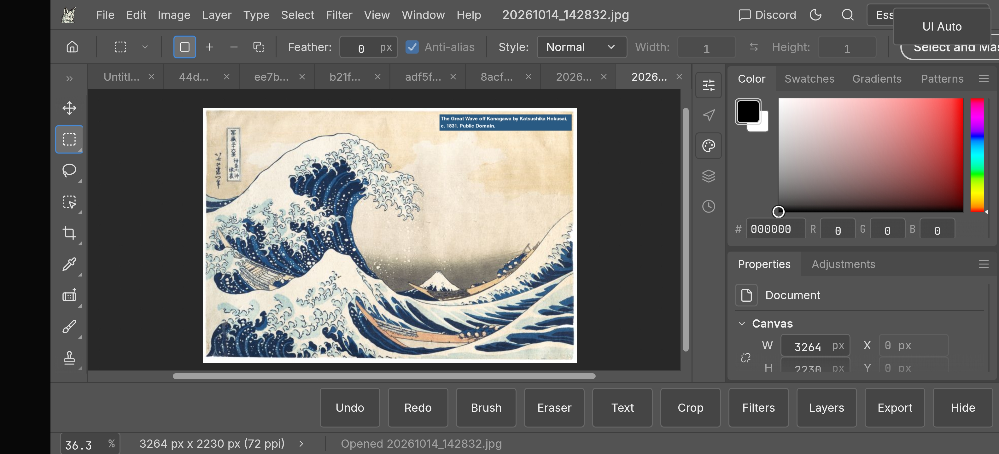

# Apelles

<p align="center">
  <a href="https://github.com/Paplo-painite/apelles">
    
  </a>
</p>

<p align="center">
  <strong>Image editing, rebuilt in pure Rust.</strong><br>
  Apelles: a powerful mobile-first image editor for Android, built from scratch using Rust.
</p>

<p align="center">
  
  
  
  
</p>

<p align="center">
  <a href="https://github.com/Paplo-painite/apelles/releases/latest">Download APK</a> ·
  <a href="https://github.com/Paplo-painite/apelles/discussions">Discussions</a> ·
  <a href="https://github.com/Paplo-painite/apelles/tree/main/docs">Docs</a> ·
  <a href="https://github.com/Paplo-painite/apelles/issues">Issues</a> ·
  <a href="https://github.com/Paplo-painite/apelles/blob/main/CONTRIBUTING.md">Contributing</a>
</p>

## Download Apelles for Android

[Download the latest APK from GitHub Releases](https://github.com/Paplo-painite/apelles/releases/latest)

The current Android release is a **pre-release testing build**. It supports `arm64-v8a` and
`x86_64`; enable installation from the relevant source on Android before installing it. Check the
release notes for the supported Android version and verify the published SHA-256 digest when
available.

<p align="center">
  
  <br>
  <sub>Apelles running on Android with a mobile-first editing interface for painting, layers, tools, and export.</sub>
</p>

<p align="center">
  
  <br>
  <sub>Brush settings, size and opacity controls, and an on-canvas preview inside the Android UI.</sub>
</p>

## Android status

**Android pre-release — suitable for testing.** Apelles is a native Android application, not a
WebView. The current build includes the Android shell, Storage Access Framework file selection,
project save/export, autosave and recovery, touch-oriented scaling, Arabic/RTL text support, and
imported font support. Some advanced editing workflows and device-specific GPU behavior remain
under active development.

## What Apelles includes

- Layer-based editing workflows
- Real PSD compatibility and layered document support
- Adjustment layers, masks, type, vector shapes, and filters
- Brush engine and live editing for common Photoshop-style operations
- Native Android app with a mobile-first interface
- Offline-first editing and local crash recovery
- Arabic and RTL text shaping with imported font support
- Clean-room engine built in Rust

## Privacy

Apelles works offline and does not require the Android `INTERNET` permission. Images, projects,
recovery data, and imported fonts remain on the device unless you explicitly export or share them.
The APK does not upload your images to a remote service.

## Quick start

### Build from source

```bash
git clone https://github.com/Paplo-painite/apelles.git
cd apelles
cargo run --release -p apelles -- --help
```

### Build the Android app

See [`README_ANDROID.md`](README_ANDROID.md) and [`android/README.md`](android/README.md) for
Android SDK, NDK, Rust target, and packaging instructions.

```bash
./packaging/android/build-native.sh
```

The build produces an APK for `arm64-v8a` and `x86_64` under
`packaging/android/app/build/outputs/apk/release/`.

## Repository layout

```text
apps/           Android app and supporting web/PWA targets
crates/         Core Rust crates for image editing, PSD IO, text, rendering, and UI logic
assets/         Icons, fonts, and bundled assets
book/           Documentation book
docs/           Project docs and design notes
packaging/      Android packaging and release scripts
```

## Contributing

We welcome contributions from developers, designers, testers, and artists.

Before you start:

- Read [`AGENTS.md`](AGENTS.md)
- Check the current issues and discussions
- Prefer small, focused pull requests
- For Android bugs, include the device model, Android version, ABI, and reproduction steps

Suggested workflow:

```bash
git clone https://github.com/Paplo-painite/apelles.git
cd apelles
cargo test --workspace
```

If you are working on a feature or bug fix, try to keep the change scoped and testable.

## Developer notes

- Android app and packaging instructions: [`README_ANDROID.md`](README_ANDROID.md)
- Android build notes: [`android/README.md`](android/README.md)
- Full project docs: [`book/`](book/)
- Contributor guidance: [`AGENTS.md`](AGENTS.md)
- Release history: [`CHANGELOG.md`](CHANGELOG.md)

## Community and support

- Maintainer: [Paplo-painite](https://github.com/Paplo-painite)
- Discord: https://discord.gg/artcraft
- App page: https://getartcraft.com/apps/apelles

## License

Apelles is dual-licensed under the MIT and Apache-2.0 licenses.

See:

- `LICENSE-MIT`
- `LICENSE-APACHE`
- `NOTICE`
- `ATTRIBUTION.md`

## Star history

[](https://www.star-history.com/?repos=Paplo-painite%2Fapelles&type=date&legend=top-left)
